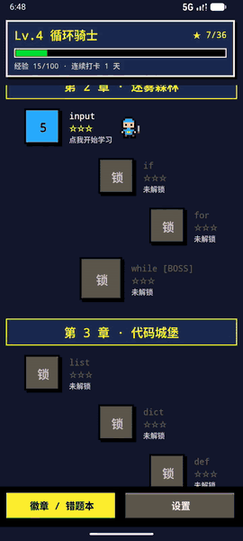

# Python 起步：像素闯关学 Python 的安卓 App

[](https://github.com/ddddddd05/py-starter-app/actions/workflows/ci.yml)

一个安卓原生 App：用**像素风闯关游戏**带完全没学过编程的人入门 Python。12 关分 3 章，每关**先学后闯**：小法师用卡片和比喻讲概念、可以动手改代码运行，学会了再去打小怪、精英和 Boss。写的代码**在手机上真实运行**，做错了可以问小精灵（AI 老师）：只给提示、不给答案。

<p align="center">
  
</p>

<p align="center">模拟器录屏（4 倍速）：学习与单步慢放 → 挑战与 Boss → 复仇怪 → 结算 → 迷宫模式。完整视频（原速、带音效）：<a href="docs/demo.mp4">docs/demo.mp4</a></p>

> 开发方式：用 Claude Code 辅助开发（vibe coding），本人负责需求、玩法和交互设计、题目设计、验收和测试。玩法上的取舍和测试中发现的问题见 [docs/开发记录.md](docs/开发记录.md)。
>
> 安装包：在 [Releases](../../releases) 下载 APK，安卓手机直接安装即可，不需要后端，断网也能玩。

## 玩法

| 环节 | 说明 |
|---|---|
| 闯关地图 | 12 关分 3 章（新手村 → 迷雾森林 → 代码城堡），每章最后一关是章节 Boss；过一关才解锁下一关 |
| 先学习（不扣血） | 概念拆成小卡片 → 比喻 → 动手试一试（示例代码可改着运行，用到 `input()` 时可以自己输入）→ 1 道小练习 |
| 再挑战 | 小怪（选择题）→ 精英（填空题）→ Boss（写代码题）；每关 3 颗心，答错扣 1 颗，扣完重来；写代码可以随便“试运行”，只有“出招”错了才扣血 |
| 错因 + 台词 | 答错时小精灵用游戏台词说明错因（如“引号怪”“括号怪”），下面保留带行号的大白话报错，学得到真正的知识点 |
| 复仇怪 | 答错过的题会带着错因标签，在后面的关卡里作为“复仇怪”回来，打赢就算征服（间隔复习） |
| 星级 / 经验 / 徽章 | 没错、没看提示 3 星；看提示或翻笔记不扣血但影响星级；经验升级换称号；8 个成就徽章 |
| **单步慢放** | 点“慢放”，代码一行一行执行：当前行高亮，“变量背包”实时显示每个变量（刚变化的变黄），有新输出时小骑士砍一刀 |
| **融入式玩法** | 答对写代码题后，动画由代码的真实执行过程驱动：循环跑几轮就**连击**几刀；判断显示实际走了**哪条岔路**和条件；自己 `def` 的函数变成**技能**收进技能书 |
| MP 简洁度 | 和参考写法比较有效行数，一样简洁就额外加经验；太啰嗦会提示“试试用循环或函数” |

## 功能

| 功能 | 说明 | 技术 |
|---|---|---|
| 像素风界面 | 角色、怪物与迷宫地图用代码绘制，不用图片素材；方块按钮、硬阴影、受击 / 攻击动画 | 自定义 View、属性动画 |
| 8-bit 音效与震动 | 攻击、受击、拿星、脚步、胜利均有复古芯片音效与触觉反馈，可在设置中开关 | `AudioTrack` 纯代码合成 |
| 试炼迷宫（4 关） | 写 `move()`、`turn_right()`、`for`、`if` 直接指挥小骑士在格子地图避开 Bug 怪、捡宝石通关 | Python 逐帧记录 + `MazeView` |
| 手机快捷符号栏 | 代码框上方提供 `缩进`、`()`、`""`、`:`、`for`、`if` 快捷按键，随代码框同步显隐 | `CodeToolbar` |
| 单步慢放（可视化调试器） | Python 用 `sys.settrace` 逐行记录行号、变量、输出、循环轮次；安卓端回放 | **Kotlin + Jetpack Compose**、ViewModel + StateFlow、协程 |
| 状态保存 | 战斗和慢放的状态放在 ViewModel 里，旋转屏幕等页面重建时不丢进度 | Jetpack ViewModel |
| 讲解 + 示例 | 大白话、比喻、可运行的示例代码 | — |
| 三种题型 | 选择、填空、自己写代码（策略模式 + 工厂映射解耦） | 策略模式、`QuestionStrategy` |
| 手机上运行 Python | 学生写的代码在 App 内嵌的 Python 解释器里执行，死循环/超大 `range` 自动停止，危险操作被拦截，报错翻译成大白话并标出第几行 | Chaquopy |
| 判题 | 真的运行代码、比对输出，并检查是否用了这一关要练的写法（如 for 循环），不让 AI 猜对错 | Python `ast` |
| AI 老师 | 三级提示，一次比一次具体；程序检查回复里有没有泄露答案，泄露就换成内置提示；没网、没填 Key 时自动做离线报错诊断 | DeepSeek API（OpenAI 兼容） |
| 错题本、打卡 | 做题记录保存在手机本地，错题可以重做，连续学习天数；进度页使用 Stream 聚合统计 | Room、Java 8 Stream |
| 全服排行榜（可选） | 不联网照常玩；连接后端后可上传星数/经验并查看全服 Top 50 | OkHttp + Spring Boot + MyBatis-Plus + Caffeine + MySQL |
| 演示模式 | 首页/设置页支持一键解锁全部 12 关与迷宫，方便快速展示与体验 | `GameStore` |
| 每日提醒 | 晚上 8 点，今天还没学才提醒 | WorkManager、通知 |

## 结构

```
app/src/main/java/com/pystarter/app/     安卓原生部分（Java + Kotlin 混合）
  PyStarterApp.java      启动内嵌 Python、通知渠道、安排提醒
  PyBridge.java          Java 调 Python：后台线程执行，结果回到主线程
  MainActivity.java      闯关地图（章节、解锁、星级、等级经验）
  LessonActivity.java    学习：概念卡片、比喻、动手试一试、小练习
  BattleActivity.java    挑战：三场战斗、生命值、提示、翻笔记、复仇怪、融入式动画
  BattleViewModel.kt     挑战状态（Kotlin），旋转屏幕不丢
  debug/                 单步慢放：StepDebugActivity + StepDebugViewModel（Kotlin + Compose）
  ResultActivity.java    结算：星级、经验明细、升级、新徽章
  QuestionActivity.java  错题本里单独重做一道题
  ProgressActivity.java  进度、徽章和错题本
  SettingsActivity.java  API Key、提醒开关
  ReminderWorker.java    每日提醒
  game/                  像素角色（字符画）、动画
  data/                  Room 数据库（做题记录、打卡）+ GameStore（解锁、星级、经验、徽章、复仇怪）
app/src/main/python/pystarter/           核心逻辑（Python）
  lessons.py             12 关内容和题目
  game.py                闯关层：章节、学习卡片、小练习、怪物、错因标签、NPC 台词、融入式事件、MP
  tracer.py              单步跟踪器：sys.settrace 逐行记录现场
  runner.py              安全运行学生代码、翻译报错
  checker.py             判题
  tutor.py               AI 老师（三级提示 + 防泄露答案）
  api.py                 给 Java 调用的接口（统一返回 JSON，判题结果带 events 字段驱动动画）
tests/test_core.py       Python 核心逻辑的离线测试
tests/test_game.py       闯关层的测试（小练习答案真实运行校验、错因标签、融入式事件、MP）
tests/test_tracer.py     单步跟踪器的测试
app/src/test/            JUnit 单元测试（闯关规则）
app/src/androidTest/     Espresso UI 测试（主流程）
.github/workflows/ci.yml GitHub Actions
```

**为什么用 Java + Kotlin + Python**：原有页面用 Java + View 写；新功能（单步慢放、ViewModel）用现在安卓主流的 Kotlin + Jetpack Compose 写，两者在同一个项目里共存。因为要在手机上真实运行学生写的 Python，所以用 Chaquopy 把 Python 解释器打包进 App，判题、单步跟踪和 AI 老师的逻辑也用 Python 写。

## 测试

| 层 | 命令 | 数量 | 测什么 |
|---|---|---|---|
| Python 核心 | `python -m pytest -q` | 162 | 判题、报错翻译、闯关层、单步跟踪器、4 关迷宫；**题目内容自检**：每道写代码题的参考答案必须通过自己的判题，每道选择题和小练习都真的运行代码核对正确选项 |
| 安卓单元测试（JUnit） | `./gradlew testDebugUnitTest` | 20 | 星级、结算防刷经验、解锁、徽章、连续打卡等规则（抽成纯函数，在电脑上跑） |
| 安卓 UI 测试（Espresso） | `./gradlew connectedDebugAndroidTest` | 2 | 在模拟器上走主流程：地图 → 学习 → 小练习 → 挑战 → 答错扣心 → 答对打倒小怪 |

[GitHub Actions](.github/workflows/ci.yml) 每次推送都会自动跑这三层测试，并把调试版 APK 作为构建产物上传。

> 注意：UI 测试会清空 App 的闯关进度，测试结束后 Gradle 还会卸载 App。在自己常用的模拟器或手机上跑之前，先备份数据。

## 运行

用 Android Studio 打开本目录，等 Gradle 同步完成，选择模拟器或真机运行。AI 老师需要在 App 的“设置”里填 API Key（只保存在手机上）；不填也能用内置提示。

也可以不打开 Android Studio，用命令行打包（需要 JDK 17+ 和 Android SDK Platform 35）：

```powershell
.\gradlew.bat assembleDebug      # Windows；macOS / Linux 用 ./gradlew assembleDebug
```

安装包生成在 `app/build/outputs/apk/debug/app-debug.apk`。连上手机或开着模拟器时，用 `installDebug` 可以直接装上。

### 正式版（压缩 + 拆分 + 签名）

```powershell
.\gradlew.bat assembleRelease
```

- **R8 压缩**：删除没用到的代码和资源；
- **按 CPU 架构拆分**：`app-arm64-v8a-release.apk`（真机）约 25 MB，比调试版（约 48 MB）小将近一半；另有一个任何手机都能装的通用包 `app-universal-release.apk`；
- **签名**：密钥不进仓库。在项目根目录放一个 `keystore.properties`（已加入 `.gitignore`），或设置环境变量 `PYSTARTER_STOREFILE` 等：

  ```properties
  storeFile=release.jks
  storePassword=你的密码
  keyAlias=pystarter
  keyPassword=你的密码
  ```

  没有密钥时，正式版会临时用调试密钥签名，方便别人克隆后直接编译测试。

### 复现环境

| 需要 | 版本 | 说明 |
|---|---|---|
| JDK | 17 及以上（已用 21 验证） | Android Studio 自带的也可以 |
| Android SDK | Platform 35 | Build-Tools 34 第一次打包时会自动安装；SDK 路径写在 `local.properties` 的 `sdk.dir`，或设置环境变量 `ANDROID_HOME` |
| Python | 3.10 及以上 + `pytest` | 只用于在电脑上跑测试；App 里内嵌的是 Chaquopy 自带的 Python 3.12，不依赖电脑上的 Python |
| 网络 | 第一次打包需要 | 会下载 Gradle（腾讯云镜像）、依赖（阿里云镜像）和 Chaquopy 的 Python 运行环境，之后有缓存 |

已验证：只用仓库里的文件（不带任何本地缓存）放到新文件夹，跑测试全部通过，`assembleDebug` 能打出安装包。

**Windows 用户名是中文时**：打包可能报 `Unable to establish loopback connection`。这是 Java 在临时目录路径含中文时的已知问题，把临时目录换成纯英文路径即可：

```powershell
$env:TEMP = "C:\gradle-tmp"; $env:TMP = $env:TEMP
$env:JAVA_TOOL_OPTIONS = "-Djava.io.tmpdir=C:\gradle-tmp -Djdk.net.unixdomain.tmpdir=C:\gradle-tmp"
.\gradlew.bat assembleDebug
```

## 局限

- 只有安卓端（iOS 原生需要 macOS 和 Xcode）；
- 代码运行的安全限制是教学级别的，不等于真正的沙箱；
- 题库是固定的 12 关 36 题。
